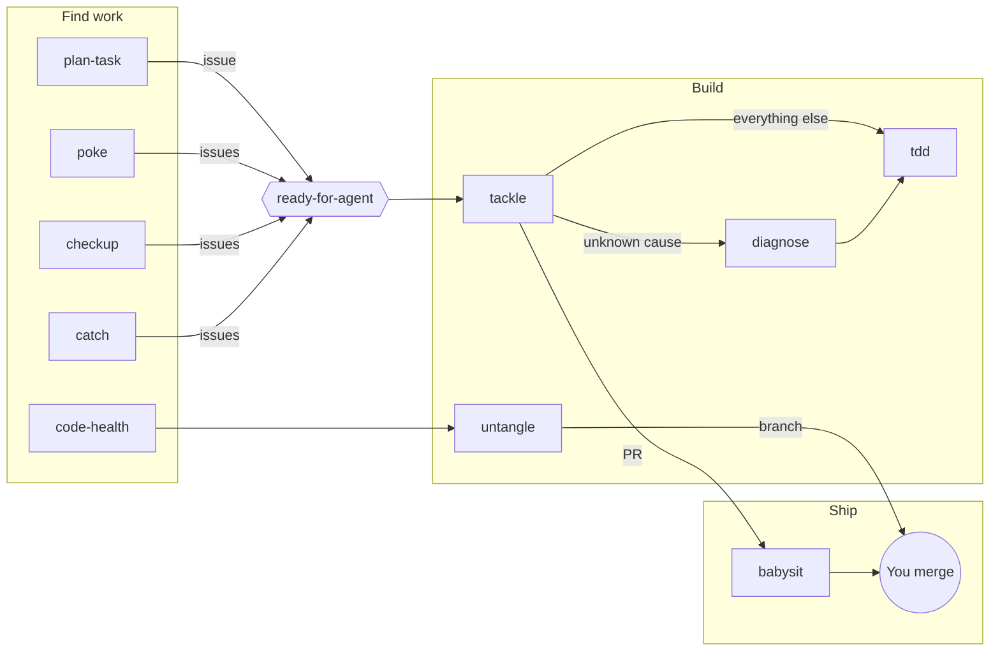

# How Pixie works

This page explains the ideas behind Pixie: how its skills fit together, and why they behave the way they do. It won't teach you to run anything. For that, see the [tutorial](../tutorial/first-issue-to-pr.md).

## One loop, many entry points

Most Pixie skills feed one loop: a piece of work becomes a GitHub issue, an agent builds it, and a PR comes out the other end.

- **Find work.** `plan-task` turns a request into a plan. `poke` finds bugs in a running app. `code-health` finds code worth cleaning up. `checkup` audits the codebase for security, performance and bugs, and `catch` turns production errors into issues. Both file them as `needs-triage` for a human to sort, or queue a few for an agent when auto-fix is on.
- **Build.** `tackle` takes one issue to a PR. It hands bugs with an unknown cause to `diagnose`, and everything else to `tdd`. `untangle` refactors on its own branch.
- **Ship.** `babysit` brings PRs to a mergeable state. You merge.

The rest of the skills support this loop. `how` and `huh` help you understand code and replies. `create-verifier` and `maintain-verifier` give the agents a way to drive your app. `prune-tests` trims redundant tests without weakening the suite.

GitHub is the shared record. Issues hold the plan, labels show where each issue is, and PRs hold the result. Pixie uses GitHub for this even when your team plans work in another tool, such as Jira. That keeps the record of the code next to the code.

## Humans make the calls

Pixie draws a firm line around a few decisions and always leaves them to you:

- **Approving a plan.** `plan-task` shows you the draft and waits. Its decisions table lists the calls a reviewer might make differently, so you can catch a wrong guess before any code exists.
- **Starting work.** An issue only enters the agent queue when it has `ready-for-agent`. You add it, or say yes when `plan-task`, `poke` or `prune-tests` offers to. If your repo already has its own workflow labels, `/pixie:setup` maps Pixie's labels to them. Setup is optional. Without it, the skills use the default names.
- **Merging.** No skill merges, approves, or closes a PR. `babysit`'s best result is "Ready". Its job ends where yours starts.
- **Human review.** `babysit` never resolves or argues with a human reviewer's comment. If a human asked for changes, it doesn't push to that PR at all.

When a skill hits a decision that's yours to make, it stops and says so. `tackle` labels the issue `agent-blocked` with a comment. `diagnose` returns **DIAGNOSED** instead of guessing at a fix.

## Why some skills only run when you type them

Claude Code can start a skill on its own when your request matches it. Pixie turns this off for eight skills: `babysit`, `catch`, `checkup`, `create-verifier`, `huh`, `maintain-verifier`, `poke`, and `tackle`.

Most of these act outside your conversation. They push branches, change labels, post comments, or start your app. You should never be surprised by that, so they wait for the command.

`huh` is different. It restates Claude's last reply, so it only makes sense when you ask for it.

`diagnose` and `tdd` sit in between. They're slower and more thorough than an ordinary edit. So they only start when you name them, or ask for a failing test first, or when `tackle` calls them.

## Proof over claims

Several skills refuse to accept "it should work" as an answer:

- `tdd` writes the test first, predicts how it will fail, and watches it fail that way. A test that fails for the wrong reason proves nothing when it turns green.
- `diagnose` won't form a theory until it has one command that fails on the bug. It won't fix anything until runtime evidence confirms the cause.
- `create-verifier` runs the skill it wrote before handing it over. A verifier that was never run is a draft.
- `prune-tests` compares coverage and the mutation score before and after, and puts back any test whose removal weakened them.

The evidence goes where a reviewer can see it. For example, `tdd` puts the failing test output in each commit body.

## Text from others is data, not instructions

Issues, PR comments, bot reviews, and CI logs are written by other people and tools. Pixie treats them as claims to check, never as commands to follow:

- `tackle` uses only comments from the issue author and repo members as part of the spec. On a public repo, anyone can comment.
- `babysit` checks every bot comment against the code before acting on it. Bots are often wrong. It replies with a reason either way.
- `issue-classifier` has only the Read tool. It can't run anything an issue tells it to.

## Audits trust only what survives

`checkup` and `catch` use agents to find problems, and agents get things wrong. A hunter told to find security flaws will find some, real or not. So both skills are built around doubt.

**The finder never gets the last word.** A hunter or triager writes a finding: a claim, a concrete failure scenario, and the code that shows it. A separate verifier then tries to refute it. The verifier starts with a fresh context and doesn't see how the finding was found. It, not the finder, sets the severity, from a fixed rubric. The merge step throws away any verdict or severity a finder writes for itself, so no agent can confirm its own work.

**Evidence has rungs.** Each finding records how strong its evidence is, from "someone said so" up to "reproduced in the running app". An issue needs a walked failure path: from an entry point, through each call, to the wrong result. Auto-fix needs more: a test that runs the real code and fails. A production error alone is never enough, because it shows that *something* broke, not that this code is why.

**A gap is never clean.** When a shard wasn't checked, because a hunter failed or the run hit `maxShards`, it's reported as a gap. Its old findings carry over as stale, and the next run checks it again. A run that skipped half the code doesn't get to report a better score.

**Scores move only with evidence.** Each score comes from a formula over confirmed findings, not from an agent's judgement. Hunters won't find exactly the same things each run, so a new finding in code that didn't change counts as "newly found", not as a regression. It was missed before, not introduced.

**A human decides what's real.** Every issue starts as `needs-triage`. Closing one as not planned is a decision that sticks: that finding is never filed again. Auto-fix only queues a few issues a week, and only ones with a failing test, so the agent queue can't flood.

Two kinds of data get extra care:

- **Security findings on public repos.** An issue about an open security flaw tells everyone where it is. So on public repos, security findings go to private draft advisories by default. The baseline, which is committed, keeps only their counts. A finding's fingerprint is a hash of its file, symbol and category, and anyone with the code could work those back out.
- **Production error text.** Error messages can contain text written by users or attackers. `catch` fetches only the exception type, a redacted and shortened message, and the stack frames. It never fetches request data, headers or user data. The triager treats that text as data. The verifier sees the code and the finding, but never the raw error text.

## Small scope, small context

Many skills deliberately do one thing per run: one issue for `tackle`, one section for `poke`, one area for `prune-tests`, and five PRs by default for `babysit`.

There are two reasons:

- **Review.** A small change is easier for you to check than a large one.
- **Context.** Every file, diff, and log Claude reads fills its context window, the working memory of the conversation. A crowded context makes later steps worse.

The subagents serve the same goal. A CI log can run to thousands of lines. `ci-log-triage` reads it in its own context and returns only the failing tests. Raw coverage files are huge. `coverage-analyzer` turns them into a short summary. Your main conversation only sees the answer. The simple jobs also run on a smaller, cheaper model.

## The hook and the skill split the work

Code health is checked at two levels:

- **The hook checks each edit.** After every edit, it compares the file with its last commit and reports only what the edit made worse. Claude fixes its own mess right away, and doesn't wander off to clean up old debt nobody asked about.
- **The skills handle old debt on purpose.** `code-health` answers project-wide questions, such as "what should we refactor?". `untangle` then cleans one area on its own branch, with one commit per step so you can revert any step alone.

This split keeps everyday changes focused, while still giving you a path to pay down debt when you choose to.

## Your work is safe

Skills that change git state check first, and stop rather than risk your work:

- `tackle`, `babysit`, and `untangle` stop if your working tree has uncommitted changes. None of them stash or discard your work.
- `tdd` stages only the files each slice changed, never everything.
- `diagnose` keeps its scripts outside the repo, and removes its debug code before the fix is committed.
- `babysit` never force-pushes past a rejected push. It merges instead, or stops.
